# PedPack: the problem, the runs, and the claim

This note is the working account of what we set out to measure, how the code
does it, and which numbers we are willing to stand behind. The longer draft
is `docs/manuscript.md`. The tables and figures below are the ones written
by the runs in `results/`. A ratio below 1 is a lower objective than the
reference on that row. `pedpack` is the pedigree-aware search.
`pedpack_no_pedigree_features` is the same search with pedigree identity
turned off.

PedPack is a storage policy for an opaque block engine and for a distributed
blob store. The reader gets a byte range. It does not get a named column.
That is the system in which co-locating a nuclear family inside a tile
changes how many bytes a family query has to pull. Hail and Parquet are in
this note because they are the systems where that assumption fails: column
projection already returns the named samples, and packing families into
extra files adds opens without removing bytes.

## The problem

A dosage matrix has M variants and N samples. Two kinds of query hit it.

A scan wants every sample, usually for QC or an allele frequency. A
family query wants a few nuclear families inside a variant window: the
affected child, both parents, sometimes a second family that shares a
parent. In a clinical or rare-disease setting that is a small slice of the
cohort, about 5–15% of the families, not a biobank-wide pass.

The storage system does not see that distinction unless the bytes are laid
out for it. A logical tile is one group of samples over a contiguous run of
variants. Tiles are packed into files. A read pulls whole tiles and rounds
up to the block size. If a person belongs to two groups, both copies are
stored. The planner reads one covering set.

That overlap is the whole difficulty. On a two-generation pedigree a person
is a child in one nuclear family and a parent in another, so a nuclear
layout stores some people twice. We measure that as duplication: stored
sample-slots divided by N. On our two-generation draws it sits around
1.21–1.30. On three-generation draws with a lot of cross-family pairing it
climbs to about 1.42–1.44. A layout that co-locates every trio can still
lose, because the extra copies are paid on every scan.

The design choice, made before the queries arrive, is four things at once:

- which samples share a tile
- how wide the tile is along the variant axis
- how tiles are packed into files (`naive`, `count:k`, or `bytes:B`)
- whether the write order is group-major or locus-major

The score is one number, in seconds:

```
C = build + ω · replicated storage
  + H · (0.35 · mean scan + 0.40 · mean family + 0.25 · mean extended)
```

H is 32. ω prices the reference all-samples layout as a quarter of a
reference scan. Build, storage, and query time are all in the same sum.
A method that only reports selective read bytes is answering a smaller
question than the one we posed.

## How the code answers it

`src/pedpack/study.py` is the protocol. One seed does this:

1. Draw a pedigree (`simulate_pedigree`) or read a PED file (`parse_ped`).
   Kinship is the Karigl/Lange recursion, computed in topological order and
   then permuted with the sample columns.
2. Simulate dosages. Founders draw two alleles. Children inherit one allele
   from each parent. The study aborts if a Mendelian check fails. Columns
   are scrambled so an index-contiguous chunk is not accidentally a family.
3. Build a pool of layouts: all-samples, scrambled index chunks, nuclear
   families, three-generation groups, kinship agglomeration, and one fixed
   nuclear heuristic that does not search.
4. Score every layout with a closed-form model (`src/pedpack/cost.py`).
   Keep the best B (36 on the small pool, 24 on the large ones) and measure
   those on the block simulator. The winner of that measured shortlist is
   `pedpack`.
5. Run the same search with the pedigree terms turned off. That ranker
   still sees group sizes and packing. It does not see who shares a group,
   it applies no kinship compression, and it treats co-location as mean
   group size over N. That method is `pedpack_no_pedigree_features`.
6. Also score exhaustive winners inside each grouping. Those oracles are
   analysis bounds. They are not a system a user would run. `pedpack` is
   doing its job when its fit cost matches the exhaustive winner.

The simulator places one task per touched file. Replica r of block b in
file f lands on node `(h + r) mod n_nodes`. A task runs on the live node
that holds the most replicas of the blocks it touches. Anything else is
remote. Trio shuffle is charged when a query's father, mother, and child
are not in one group. The analytical model uses the same group cover and
the same kinship-compressed tile sizes. Its remote fraction is a formula,
not a replay of that placement, so it ranks well and underestimates
absolute seconds. Search uses the ranking.

The neural ranker in `models.py` is not the method. Later studies set
`secondary_neural` to false. Where a report prints "Neural ranker: not
run", that is intentional.

Workloads are fixed before anyone looks at a winner. Fit queries choose
the layout. Held-out family queries use different families and freshly
drawn windows, and they are not in the objective. A ratio below 1 against
`generic_oracle` is a win on that workload. A ratio near 1 against
`full_oracle` means the budgeted search found the exhaustive winner.

## What came out of the simulator

Seeds are 7, 11, and 19 throughout. Variance is across pedigrees, not
across reruns of one draw.

### The gap, on a small two-generation cohort

`configs/pedigree_gap.json`, `results/pedigree/`. Ten founder couples, two
generations, 1,600 variants, 64 KB blocks, 400 bytes per genotype. About
58–76 people. Nuclear duplication is about 1.21–1.27.

`pedpack` selects nuclear families and matches the family oracle and the
full oracle (fit/oracle = 1.000). The blind ranker selects all-samples and
matches the variant oracle. Median fit cost of `pedpack` is 0.286× the
best index-chunk layout. Held-out family bytes for all-samples against the
family layout are about 7.7–8.6×.

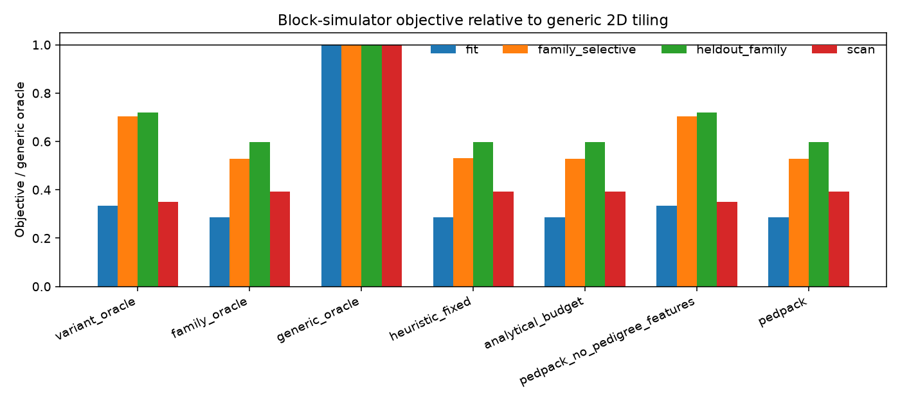

Median ratios. `generic` is the best index-chunk layout. `oracle` is the
best layout in the whole pool.

| Method | Fit / generic | Family / generic | Extended / generic | Held-out family / generic | Scan / generic | Fit / oracle |
| --- | ---: | ---: | ---: | ---: | ---: | ---: |
| heuristic_fixed | 0.286 | 0.530 | 0.637 | 0.597 | 0.392 | 1.007 |
| variant_oracle | 0.335 | 0.703 | 0.680 | 0.720 | 0.349 | 1.168 |
| family_oracle | 0.286 | 0.527 | 0.636 | 0.597 | 0.392 | 1.000 |
| generic_oracle | 1.000 | 1.000 | 1.000 | 1.000 | 1.000 | 3.498 |
| pedigree_oracle | 0.286 | 0.527 | 0.636 | 0.597 | 0.392 | 1.000 |
| full_oracle | 0.286 | 0.527 | 0.636 | 0.597 | 0.392 | 1.000 |
| random_budget | 0.287 | 0.529 | 0.636 | 0.596 | 0.394 | 1.003 |
| analytical_budget | 0.286 | 0.527 | 0.636 | 0.597 | 0.392 | 1.000 |
| pedpack | 0.286 | 0.527 | 0.636 | 0.597 | 0.392 | 1.000 |
| pedpack_no_pedigree_features | 0.335 | 0.703 | 0.680 | 0.720 | 0.349 | 1.168 |

Fit-mix execution, median across seeds 7, 11, and 19.

| Method | Objective | Mean seconds | Mean bytes | Remote fraction | Mean shuffle |
| --- | ---: | ---: | ---: | ---: | ---: |
| pedpack | 3.224 | 0.048 | 4.799e+06 | 0.580 | 0.000 |
| pedpack_no_pedigree_features | 3.705 | 0.073 | 7.431e+06 | 0.616 | 0.000 |
| variant_oracle | 3.705 | 0.073 | 7.431e+06 | 0.616 | 0.000 |
| family_oracle | 3.224 | 0.048 | 4.799e+06 | 0.580 | 0.000 |
| generic_oracle | 11.277 | 0.225 | 7.383e+06 | 0.612 | 1.500e+07 |
| heuristic_fixed | 3.224 | 0.048 | 4.799e+06 | 0.558 | 0.000 |

Build, storage, and query on the fit mix, median.

| Method | Build (s) | Storage (s) | Query (s) | Amortized s/query | Amortized s/sample |
| --- | ---: | ---: | ---: | ---: | ---: |
| pedpack | 0.863 | 0.053 | 0.069 | 0.101 | 1.397e-03 |
| pedpack_no_pedigree_features | 0.783 | 0.047 | 0.089 | 0.116 | 1.631e-03 |
| variant_oracle | 0.783 | 0.047 | 0.089 | 0.116 | 1.631e-03 |
| generic_oracle | 1.148 | 0.047 | 0.311 | 0.352 | 4.874e-03 |
| heuristic_fixed | 0.863 | 0.053 | 0.069 | 0.101 | 1.414e-03 |

Fit objective on each seed.

| Seed | People | PedPack layout | PedPack | No-pedigree layout | No-pedigree |
| ---: | ---: | --- | ---: | --- | ---: |
| 7 | 76 | `family\|g=20\|w=400\|count:16` | 3.224 | `variant\|g=1\|w=100\|count:16` | 3.797 |
| 11 | 58 | `family\|g=16\|w=1600\|count:16` | 2.592 | `variant\|g=1\|w=100\|count:16` | 3.026 |
| 19 | 67 | `family\|g=19\|w=800\|count:16` | 3.345 | `variant\|g=1\|w=100\|count:16` | 3.705 |

| Seed | heuristic_fixed | variant_oracle | family_oracle | generic_oracle | full_oracle | pedpack | pedpack_no_pedigree_features |
| ---: | ---: | ---: | ---: | ---: | ---: | ---: | ---: |
| 7 | 3.224 | 3.797 | 3.224 | 11.277 | 3.224 | 3.224 | 3.797 |
| 11 | 2.624 | 3.026 | 2.592 | 9.046 | 2.592 | 2.592 | 3.026 |
| 19 | 3.369 | 3.705 | 3.345 | 12.362 | 3.345 | 3.345 | 3.705 |

Analytical seconds MAPE on layouts held out of the pilot is 0.215.
Spearman of the analytical objective is 0.987.

The early negative run is `results/small/`: 48 bytes per genotype, 256 KB
blocks, a heavier scan share. Both rankers stay on all-samples. That
config is a different workload. We do not mix it into the table above.

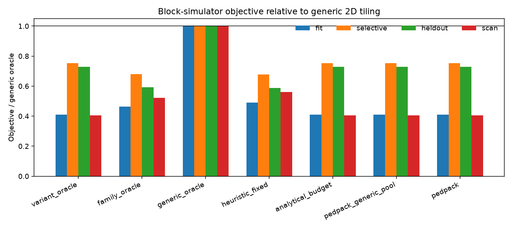

On this regime `pedpack` and the blind ranker choose the same all-samples
layouts. Median fit objective is 0.460 for both, and fit/oracle is 1.000.
Tuning the same search on selective queries alone (`pedpack_tuned_on_selective`)
moves off that layout and the fit objective gets worse (0.649 median).

| Seed | People | PedPack layout | Fit objective |
| ---: | ---: | --- | ---: |
| 7 | 76 | `variant\|g=1\|w=800\|bytes:1048576` | 0.460 |
| 11 | 58 | `variant\|g=1\|w=100\|count:16` | 0.426 |
| 19 | 67 | `variant\|g=1\|w=800\|naive` | 0.496 |

### The gap stays when the query mix moves, and it dies when copies get expensive

`results/stress/` and `docs/boundary.md`.

On two-generation pedigrees the two rankers still pick different layouts
at family fractions 5%, 15%, and 40%, and on a 50/50 scan/family mix. At
40% the objective gap on one seed shrinks to about 0.4%, while held-out
bytes stay about 2.3–2.8× apart. The layouts are still different. The
search is following a shrinking margin.

Three generations and a cross rate of 0.6 push nuclear duplication to
about 1.33–1.45. Both rankers then select all-samples, and the family
oracle is the more expensive layout. Lowering the scan share to 0.20
brings a family choice back on one of three seeds. A larger three-generation
draw (102–147 people, 3,200 variants) does the same thing: the seed at
duplication 1.45 picks all-samples; the other two pick families with fit
ratios 1.018 and 1.001. The search does not have a preference for
families. It has a preference for the cheaper layout.

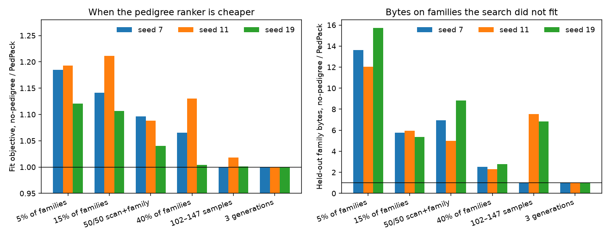

Each row is one seed. Blind / PedPack is the no-pedigree fit objective
divided by the PedPack fit objective. Held-out byte ratio is no-pedigree
bytes divided by PedPack bytes.

| Scenario | Samples | PedPack | No-pedigree | Blind / PedPack | Same layout? | Held-out byte ratio | Gap |
| --- | ---: | --- | --- | ---: | --- | ---: | --- |
| select_05 | 76 | family | variant | 1.185 | False | 13.641 | yes |
| select_05 | 58 | family | variant | 1.193 | False | 12.029 | yes |
| select_05 | 67 | family | variant | 1.121 | False | 15.719 | yes |
| select_15 | 76 | family | variant | 1.141 | False | 5.780 | yes |
| select_15 | 58 | family | variant | 1.211 | False | 5.963 | yes |
| select_15 | 67 | family | variant | 1.107 | False | 5.374 | yes |
| select_40 | 76 | family | variant | 1.066 | False | 2.528 | yes |
| select_40 | 58 | family | variant | 1.130 | False | 2.315 | yes |
| select_40 | 67 | family | variant | 1.004 | False | 2.768 | yes |
| mix_50 | 76 | family | variant | 1.097 | False | 6.944 | yes |
| mix_50 | 58 | family | variant | 1.088 | False | 5.000 | yes |
| mix_50 | 67 | family | variant | 1.040 | False | 8.828 | yes |
| overlap | 104 | variant | variant | 1.000 | False | 1.000 | no |
| overlap | 73 | variant | variant | 1.000 | True | 1.000 | no |
| overlap | 97 | variant | variant | 1.000 | True | 1.000 | no |
| scale | 147 | variant | variant | 1.000 | True | 1.000 | no |
| scale | 102 | family | variant | 1.018 | False | 7.535 | yes |
| scale | 147 | family | variant | 1.001 | False | 6.827 | yes |

On the three-generation overlap draws, family-oracle duplication is 1.42,
1.33, and 1.43, and the family oracle costs 6.344, 4.732, and 6.612 against
5.012, 4.043, and 5.294 for the variant oracle. Dropping the scan share to
0.20 (`results/stress/overlap_scan20`) moves only seed 11 onto families
(fit 3.316 against 3.502).

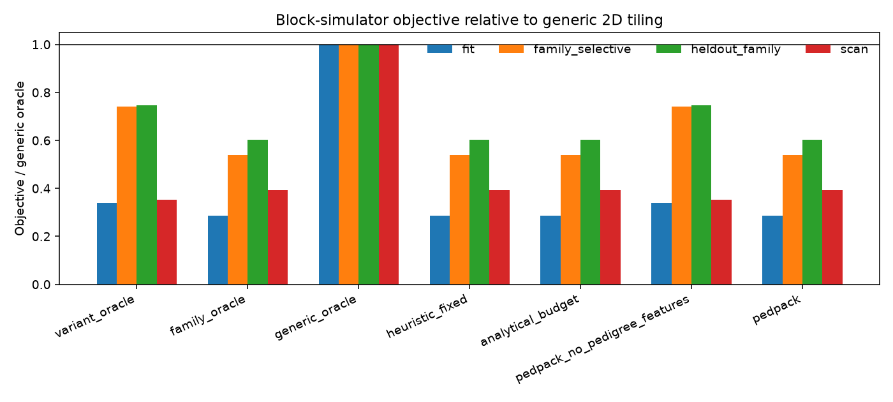

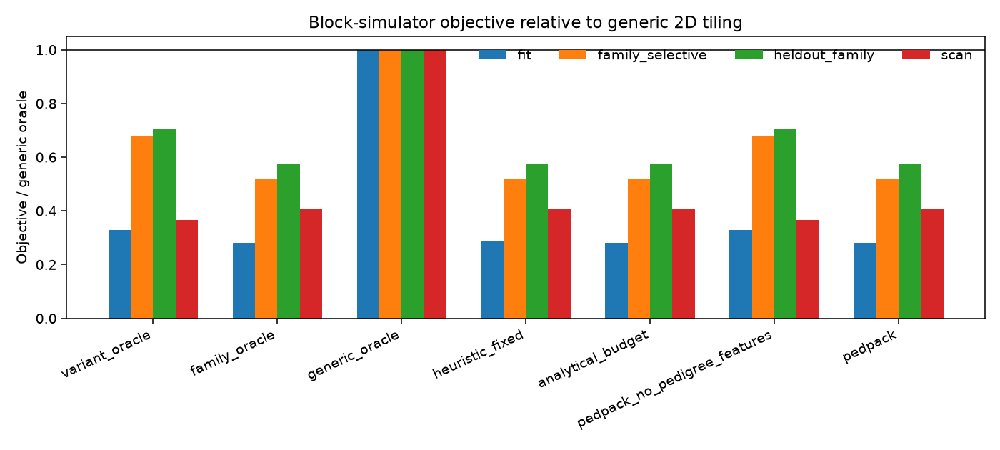

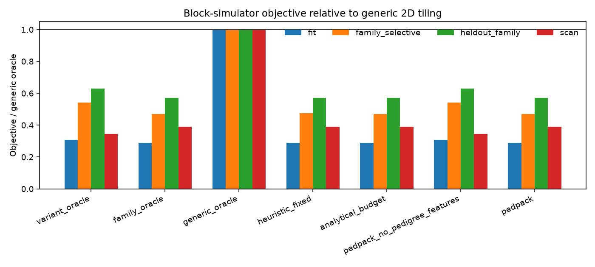

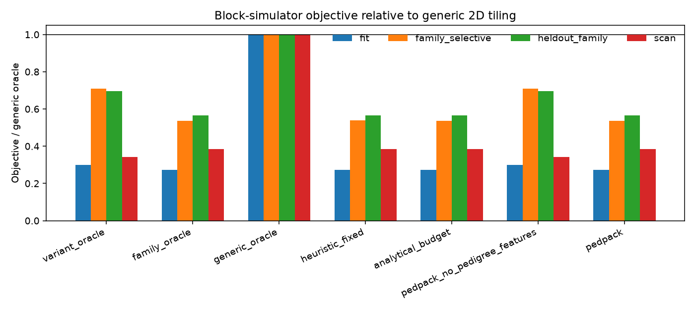

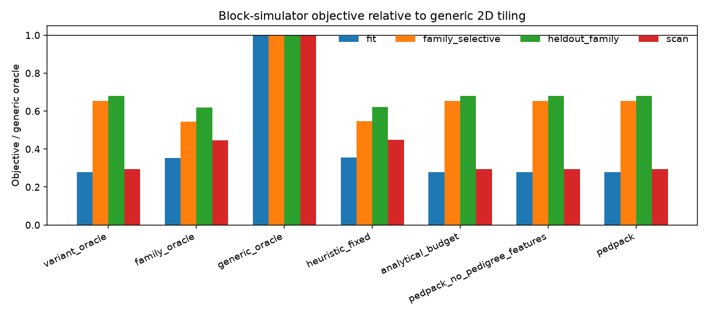


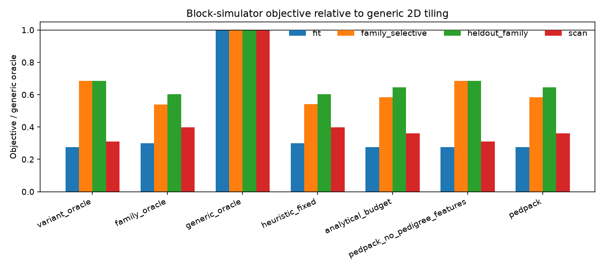

### The same split at 1,200 people and at 3,300 people

`configs/scale.json`, `results/scale/`. 180 founder couples, 8,000
variants. Seeds have 1,207, 1,175, and 1,176 people. Duplication is
1.300, 1.291, and 1.281. `pedpack` selects `count:32` nuclear families
and matches the family oracle. The blind ranker selects all-samples.
Fit objectives without pedigree features are 1.218×, 1.198×, and 1.284×
`pedpack`. Held-out family bytes are 16.7×, 16.3×, and 17.6×. Scan bytes
go the other way, 1.15–1.17×, because the overlapping parents are stored
twice. On the fit mix the family layout costs more to build (76–79 s
against 70–71 s) and more to store (4.7–4.9 s against 4.2–4.3 s). Query
time is where it wins (4.4–5.9 s against 6.5–7.8 s). Analytical Spearman
against the simulator on this pool is 0.948. Seconds MAPE is 0.280.

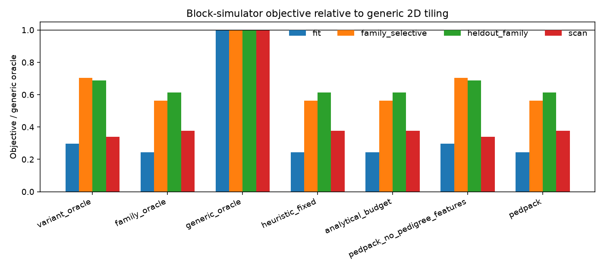

| Method | Fit / generic | Family / generic | Extended / generic | Held-out family / generic | Scan / generic | Fit / oracle |
| --- | ---: | ---: | ---: | ---: | ---: | ---: |
| heuristic_fixed | 0.244 | 0.564 | 0.702 | 0.612 | 0.378 | 1.002 |
| variant_oracle | 0.297 | 0.704 | 0.729 | 0.689 | 0.338 | 1.218 |
| family_oracle | 0.244 | 0.563 | 0.702 | 0.612 | 0.378 | 1.000 |
| generic_oracle | 1.000 | 1.000 | 1.000 | 1.000 | 1.000 | 4.097 |
| full_oracle | 0.244 | 0.563 | 0.702 | 0.612 | 0.378 | 1.000 |
| pedpack | 0.244 | 0.563 | 0.702 | 0.612 | 0.378 | 1.000 |
| pedpack_no_pedigree_features | 0.297 | 0.704 | 0.729 | 0.689 | 0.338 | 1.218 |

| Method | Objective | Mean seconds | Mean bytes | Remote fraction | Mean shuffle |
| --- | ---: | ---: | ---: | ---: | ---: |
| pedpack | 267.199 | 3.845 | 3.920e+08 | 0.622 | 0.000 |
| pedpack_no_pedigree_features | 323.605 | 6.622 | 6.748e+08 | 0.625 | 0.000 |
| generic_oracle | 1.095e+03 | 21.798 | 6.109e+08 | 0.625 | 1.562e+09 |

| Method | Build (s) | Storage (s) | Query (s) | Amortized s/query |
| --- | ---: | ---: | ---: | ---: |
| pedpack | 76.773 | 4.741 | 5.720 | 8.350 |
| pedpack_no_pedigree_features | 69.574 | 4.151 | 7.809 | 10.113 |
| generic_oracle | 107.156 | 4.150 | 30.640 | 34.206 |
| heuristic_fixed | 76.773 | 4.741 | 5.733 | 8.363 |

| Seed | People | Trios | PedPack | No-pedigree | Family oracle | Variant oracle |
| ---: | ---: | ---: | ---: | ---: | ---: | ---: |
| 7 | 1207 | 847 | 267.199 | 325.563 | 267.199 | 325.563 |
| 11 | 1175 | 815 | 270.101 | 323.605 | 270.101 | 323.605 |
| 19 | 1176 | 816 | 220.136 | 282.578 | 220.136 | 282.578 |

`configs/scale_3k.json`, `results/scale_3k/`. 500 founder couples, same
mixture, same cluster model. Seeds have 3,370, 3,361, and 3,328 people.
Duplication is 1.293–1.298. The split is the same. Blind fit objectives
are 1.244×, 1.211×, and 1.208× `pedpack`. Held-out family bytes are
16.8×, 17.3×, and 16.7×. Build and storage are again higher for families
(about 218–220 s and 13.4–13.6 s, against 197–199 s and 11.8–11.9 s).
Query time is lower (14.7–17.5 s against 20.0–23.5 s). Going from 1,200
people to 3,300 people did not move the boundary.

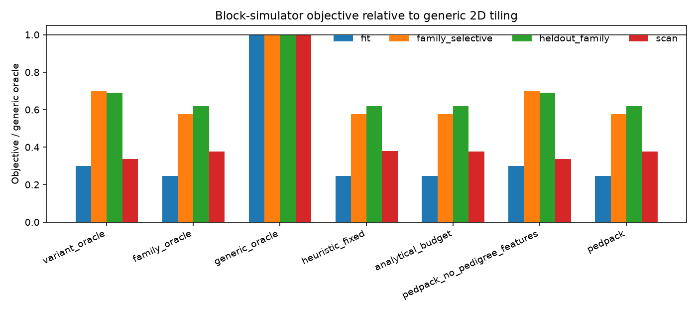

| Method | Fit / generic | Family / generic | Extended / generic | Held-out family / generic | Scan / generic | Fit / oracle |
| --- | ---: | ---: | ---: | ---: | ---: | ---: |
| heuristic_fixed | 0.246 | 0.577 | 0.717 | 0.618 | 0.378 | 1.002 |
| variant_oracle | 0.301 | 0.698 | 0.757 | 0.690 | 0.336 | 1.211 |
| family_oracle | 0.246 | 0.577 | 0.717 | 0.618 | 0.378 | 1.000 |
| generic_oracle | 1.000 | 1.000 | 1.000 | 1.000 | 1.000 | 4.070 |
| full_oracle | 0.246 | 0.577 | 0.717 | 0.618 | 0.378 | 1.000 |
| pedpack | 0.246 | 0.577 | 0.717 | 0.618 | 0.378 | 1.000 |
| pedpack_no_pedigree_features | 0.301 | 0.698 | 0.757 | 0.690 | 0.336 | 1.211 |

| Method | Objective | Mean seconds | Mean bytes | Remote fraction |
| --- | ---: | ---: | ---: | ---: |
| pedpack | 719.807 | 10.194 | 1.039e+09 | 0.622 |
| pedpack_no_pedigree_features | 895.344 | 18.552 | 1.891e+09 | 0.625 |
| generic_oracle | 2.929e+03 | 57.647 | 1.606e+09 | 0.625 |

| Method | Build (s) | Storage (s) | Query (s) | Amortized s/query |
| --- | ---: | ---: | ---: | ---: |
| pedpack | 220.306 | 13.606 | 15.184 | 22.494 |
| pedpack_no_pedigree_features | 198.923 | 11.869 | 21.375 | 27.980 |
| generic_oracle | 306.337 | 11.869 | 81.567 | 91.541 |
| heuristic_fixed | 220.306 | 13.606 | 15.226 | 22.536 |

| Seed | People | PedPack | No-pedigree | Family oracle | Variant oracle |
| ---: | ---: | ---: | ---: | ---: | ---: |
| 7 | 3370 | 719.807 | 895.344 | 719.807 | 895.344 |
| 11 | 3361 | 794.254 | 961.619 | 794.254 | 961.619 |
| 19 | 3328 | 701.647 | 847.728 | 701.647 | 847.728 |

Analytical seconds MAPE is 0.274. Spearman is 0.953.

`configs/scale_overlap.json`, `results/scale_overlap/`. 80 founder
couples, three generations, cross rate 0.6, 667–685 people. Family-oracle
duplication is 1.417–1.435. Both rankers select the same all-samples
layout. On seed 7 the family oracle costs 218.7 against 173.1 for
all-samples. More samples on the open side did not create a win. Higher
duplication on the closed side removed one.

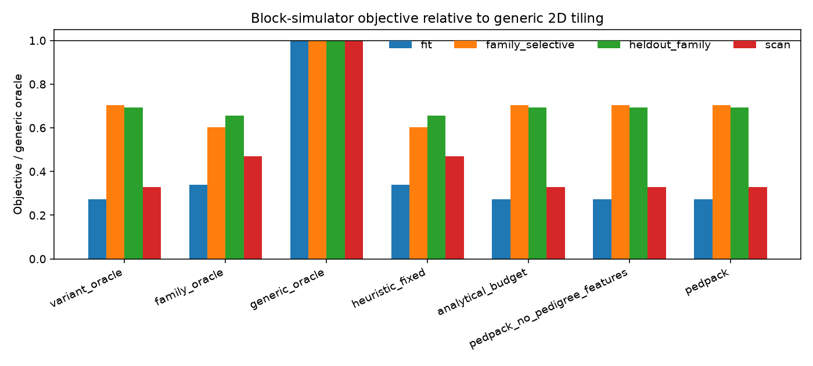

| Method | Fit / generic | Family / generic | Extended / generic | Held-out family / generic | Scan / generic | Fit / oracle |
| --- | ---: | ---: | ---: | ---: | ---: | ---: |
| heuristic_fixed | 0.340 | 0.603 | 0.724 | 0.655 | 0.470 | 1.243 |
| variant_oracle | 0.274 | 0.703 | 0.711 | 0.693 | 0.329 | 1.000 |
| family_oracle | 0.340 | 0.603 | 0.724 | 0.655 | 0.470 | 1.241 |
| generic_oracle | 1.000 | 1.000 | 1.000 | 1.000 | 1.000 | 3.654 |
| full_oracle | 0.274 | 0.703 | 0.711 | 0.693 | 0.329 | 1.000 |
| pedpack | 0.274 | 0.703 | 0.711 | 0.693 | 0.329 | 1.000 |
| pedpack_no_pedigree_features | 0.274 | 0.703 | 0.711 | 0.693 | 0.329 | 1.000 |

| Method | Objective | Mean seconds | Mean bytes | Remote fraction | Mean shuffle |
| --- | ---: | ---: | ---: | ---: | ---: |
| pedpack | 173.136 | 3.501 | 3.567e+08 | 0.625 | 0.000 |
| family_oracle | 218.730 | 3.526 | 1.943e+08 | 0.621 | 1.558e+08 |
| heuristic_fixed | 219.012 | 3.533 | 1.942e+08 | 0.614 | 1.558e+08 |
| generic_oracle | 642.186 | 12.770 | 3.514e+08 | 0.625 | 9.389e+08 |

| Method | Build (s) | Storage (s) | Query (s) | Amortized s/query |
| --- | ---: | ---: | ---: | ---: |
| pedpack | 39.885 | 2.378 | 4.105 | 5.410 |
| heuristic_fixed | 47.745 | 3.021 | 5.291 | 6.844 |
| generic_oracle | 60.565 | 2.379 | 18.111 | 20.068 |

| Seed | People | PedPack = no-pedigree = variant oracle | Family oracle |
| ---: | ---: | ---: | ---: |
| 7 | 667 | 173.136 | 218.730 |
| 11 | 675 | 182.811 | 226.889 |
| 19 | 685 | 172.014 | 192.937 |

Analytical seconds MAPE is 0.306. Spearman is 0.973.

### A formula for the same tradeoff

`src/pedpack/boundary.py` and `results/boundary/`. The formula compares
only two layouts, all-samples and nuclear, at 1,200 samples and 8,000
variants. Both are charged a remote fraction of 0.60, because the
analytical floor would hand the one-file layout a placement win the
simulator does not pay. There is no kinship compression discount in this
slice, which is conservative for families.

Family tiles win on 32 of 80 cells of duplication × family-query fraction.
At duplication 1.30 and a 5% family query the all-samples/family objective
ratio is 1.061. At duplication 1.43 and the same query it is 0.97. At
duplication 1.30 and a 60% family query it is 0.83. Simulator checks of
those two layouts at 1,600 variants agree on the sign in 8 of 12 draws.
The four misses are all cases where the formula switches to all-samples
while the simulator still picks families, by about 12% at one 15% query
and by 0.3–4.7% at 40%. The formula is early on that edge. It does not
invent a family win the simulator rejects.

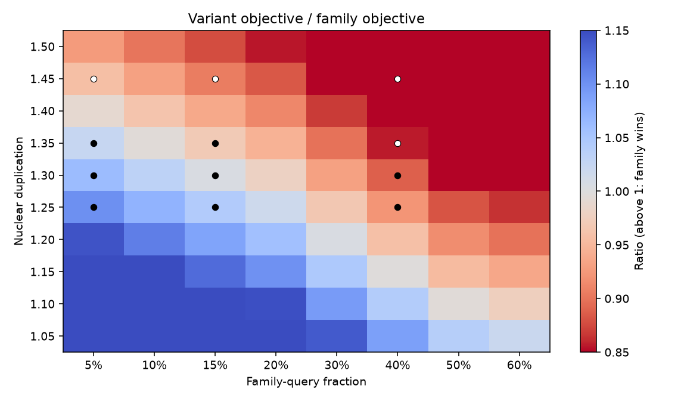

Simulator checks of those two layouts at 1,600 variants.

| Pedigree | Seed | People | Duplication | Fraction | Variant / family | Family wins |
| --- | ---: | ---: | ---: | ---: | ---: | --- |
| two_gen | 7 | 157 | 1.318 | 0.05 | 1.120 | True |
| two_gen | 11 | 139 | 1.259 | 0.05 | 1.167 | True |
| two_gen | 7 | 157 | 1.318 | 0.15 | 1.120 | True |
| two_gen | 11 | 139 | 1.259 | 0.15 | 1.126 | True |
| two_gen | 7 | 157 | 1.318 | 0.40 | 1.003 | True |
| two_gen | 11 | 139 | 1.259 | 0.40 | 1.047 | True |
| three_gen | 7 | 147 | 1.449 | 0.05 | 0.892 | False |
| three_gen | 11 | 102 | 1.333 | 0.05 | 1.041 | True |
| three_gen | 7 | 147 | 1.449 | 0.15 | 0.815 | False |
| three_gen | 11 | 102 | 1.333 | 0.15 | 1.004 | True |
| three_gen | 7 | 147 | 1.449 | 0.40 | 0.814 | False |
| three_gen | 11 | 102 | 1.333 | 0.40 | 0.904 | False |

### Zstandard on the kinship term

`results/compression/`. The byte model multiplies tile size by
`compress_base × (1 − kinship_alpha × mean kinship)`, with 0.45 and 0.55.
That term stands in for a codec that gets smaller on related haplotypes.
We compressed the simulated haplotypes and dosages with Zstandard level 3,
800-variant tiles, nuclear families against an equal-sized draw of founders.

| Regime | People | Groups | Mean kinship | Hap family/raw | Hap founder/raw | Hap family/founder | Dosage family/founder | Model family/unrelated |
| --- | ---: | ---: | ---: | ---: | ---: | ---: | ---: | ---: |
| locked | 76, 58, 67 | 55 | 0.213 | 0.165 | 0.182 | 0.907 | 0.892 | 0.883 |
| scale | 1207, 1175, 1176 | 1057 | 0.203 | 0.167 | 0.182 | 0.918 | 0.903 | 0.888 |

The relative discount is in the right direction and within a few points of
this codec. The absolute 0.45 is not the measured Zstandard/raw ratio,
which is about 0.17 on these one-byte alleles. 0.45 still prices the
opaque 400-byte genotype. This run is not PBWT.

### A public pedigree

`results/public_1kg/`. `experiments/prepare_1kg_ped.py` downloads the
1000 Genomes phase 3 pedigree (`20130606_g1k.ped`) and keeps the 3,375
people who have both parents or neither: 636 children, 2,739 founders.
Dosages are simulated on that graph. Nuclear duplication is 1.001.
There is almost no overlapping membership.

`pedpack` and the blind ranker both reject all-samples. Their fit
objectives agree to within 0.2% on every seed. Seed 19 chooses the same
layout. Seeds 7 and 11 differ in width or in family versus agglomeration,
and the costs do not. All-samples remains expensive: its fit objective is
1.42×, 1.43×, and 1.49× `pedpack`, and it reads 20.1×, 18.6×, and 19.9×
more bytes on held-out families.

Read that next to the two-generation result. When groups overlap, knowing
who shares a group changes the chosen layout. When they do not, group size
is enough, and both rankers leave all-samples. The identity term earns its
keep on the overlapping pedigrees.

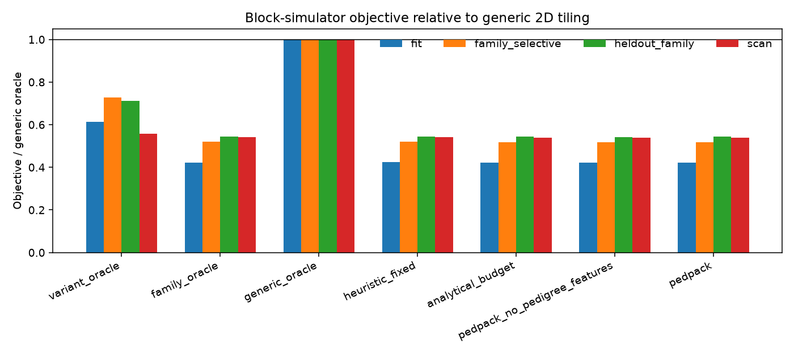

| Method | Fit / generic | Family / generic | Extended / generic | Held-out family / generic | Scan / generic | Fit / oracle |
| --- | ---: | ---: | ---: | ---: | ---: | ---: |
| heuristic_fixed | 0.425 | 0.520 | 0.630 | 0.543 | 0.542 | 1.008 |
| variant_oracle | 0.613 | 0.728 | 0.757 | 0.711 | 0.558 | 1.426 |
| family_oracle | 0.422 | 0.519 | 0.630 | 0.543 | 0.540 | 1.000 |
| generic_oracle | 1.000 | 1.000 | 1.000 | 1.000 | 1.000 | 2.372 |
| full_oracle | 0.422 | 0.519 | 0.630 | 0.543 | 0.540 | 1.000 |
| pedpack | 0.422 | 0.519 | 0.630 | 0.543 | 0.540 | 1.000 |
| pedpack_no_pedigree_features | 0.422 | 0.519 | 0.630 | 0.543 | 0.540 | 1.000 |

| Method | Objective | Mean seconds | Mean bytes | Remote fraction |
| --- | ---: | ---: | ---: | ---: |
| pedpack | 595.726 | 8.260 | 8.419e+08 | 0.618 |
| pedpack_no_pedigree_features | 595.726 | 8.260 | 8.419e+08 | 0.619 |
| variant_oracle | 889.054 | 18.667 | 1.902e+09 | 0.625 |
| generic_oracle | 1.426e+03 | 26.323 | 1.590e+09 | 0.625 |

| Method | Build (s) | Storage (s) | Query (s) | Amortized s/query |
| --- | ---: | ---: | ---: | ---: |
| pedpack | 192.390 | 11.316 | 12.254 | 18.616 |
| pedpack_no_pedigree_features | 192.295 | 11.309 | 12.254 | 18.616 |
| variant_oracle | 199.795 | 11.922 | 21.167 | 27.783 |
| generic_oracle | 307.796 | 11.922 | 34.578 | 44.569 |
| heuristic_fixed | 192.390 | 11.316 | 12.391 | 18.757 |

| Seed | PedPack layout | PedPack | No-pedigree layout | No-pedigree | Variant oracle |
| ---: | --- | ---: | --- | ---: | ---: |
| 7 | `family\|g=2110\|w=4000\|count:32` | 643.882 | `family\|g=2110\|w=8000\|count:32` | 644.853 | 915.094 |
| 11 | `family\|g=2110\|w=4000\|count:32` | 577.231 | `pedigree\|g=2107\|w=8000\|count:32` | 577.269 | 823.070 |
| 19 | `pedigree\|g=2107\|w=8000\|count:32` | 595.726 | `pedigree\|g=2107\|w=8000\|count:32` | 595.726 | 889.054 |

Analytical seconds MAPE is 0.289. Spearman is 0.951.

## What happened when we left the simulator

### One-host HDFS

`results/hdfs/`, `deploy/hdfs-compose.yml`. Hadoop 3.2.1 in Docker on this
Windows machine: one NameNode, three DataNodes, replication 3, block size
64 KB. Files are the layouts the simulator chose, padded out to the modeled
tile size. There is no codec. The client is another container, so every
block is remote. That is not the simulator's remote-read fraction.

On the selective two-generation layouts the family files return fewer
bytes, touch fewer blocks, and finish sooner. Held-out family byte ratios
(all-samples / family) are 16.4, 14.2, and 20.2 at 5% of families, about
6.5–6.9 at 15%, and 5.8–10.5 on the 50/50 mix. On the three-generation
overlap regime both rankers had chosen all-samples, and the NameNode
serves the same bytes (ratio 1.0). Replicated storage is slightly higher
for the family layouts. This is real HDFS software. It is one machine.

Held-out family reads through WebHDFS. Byte ratio is no-pedigree bytes
divided by PedPack bytes.

| Scenario | Seed | PedPack bytes | No-pedigree bytes | Byte ratio | PedPack seconds | No-pedigree seconds | PedPack blocks | No-pedigree blocks |
| --- | ---: | ---: | ---: | ---: | ---: | ---: | ---: | ---: |
| select_05 | 7 | 3.51e5 | 5.76e6 | 16.4 | 0.012 | 0.077 | 7.7 | 93.2 |
| select_05 | 11 | 3.19e5 | 4.53e6 | 14.2 | 0.022 | 0.103 | 5.8 | 74.7 |
| select_05 | 19 | 2.68e5 | 5.42e6 | 20.2 | 0.019 | 0.082 | 5.7 | 88.5 |
| select_15 | 7 | 9.8e5 | 6.81e6 | 6.9 | 0.038 | 0.083 | 23.2 | 110.2 |
| select_15 | 11 | 8.1e5 | 5.28e6 | 6.5 | 0.015 | 0.070 | 13.7 | 86.8 |
| select_15 | 19 | 8.5e5 | 5.73e6 | 6.7 | 0.021 | 0.071 | 16.5 | 93.7 |
| mix_50 | 7 | 8.6e5 | 6.77e6 | 7.9 | 0.027 | 0.080 | 17.8 | 109.3 |
| mix_50 | 11 | 9.1e5 | 5.29e6 | 5.8 | 0.018 | 0.071 | 16.3 | 86.7 |
| mix_50 | 19 | 5.8e5 | 6.10e6 | 10.5 | 0.017 | 0.076 | 12.3 | 99.3 |
| overlap | 7 | 7.66e6 | 7.66e6 | 1.0 | 0.062 | 0.073 | 118.5 | 121.7 |
| overlap | 11 | 6.77e6 | 6.77e6 | 1.0 | 0.079 | 0.072 | 109.8 | 109.8 |
| overlap | 19 | 8.35e6 | 8.35e6 | 1.0 | 0.103 | 0.119 | 133.0 | 133.0 |

On select_05 the family layout uses 72.3, 53.2, and 64.9 MB of replicated
space, against 64.6, 49.4, and 56.9 MB for all-samples. Family file counts
are 5, 1, and 3. All-samples is one file.

### Hail, local mode

Hail 0.2.139, Spark `local[2]`, the 1,207 × 8,000 matrix, seed 7.

`results/hail/` writes the family side as one exploded Table keyed by
group and variant. The Table is about 20× the MatrixTable. Nuclear
duplication is 1.30, so the extra bytes are the encoding. Query times sit
under a second. That object does not test the layout.

| Seed | Samples | Variants | Duplication | MT build s | Family build s | MT bytes | Family bytes | Held-out MT s | Held-out family s |
| ---: | ---: | ---: | ---: | ---: | ---: | ---: | ---: | ---: | ---: |
| 7 | 1207 | 8000 | 1.300 | 12.8 | 131.5 | 2962103 | 57985834 | 0.718 | 0.359 |
| 11 | 1175 | 8000 | 1.291 | 4.6 | 118.8 | 2882511 | 55997500 | 0.429 | 0.348 |
| 19 | 1176 | 8000 | 1.281 | 4.4 | 123.9 | 2887379 | 55702898 | 0.355 | 0.361 |

Seed 7 queries on that exploded table. The scan row is the one that shows
the encoding reading more entries than the MatrixTable.

| Query | Samples | Variants | Groups | MT s | MT entries | Family s | Family entries |
| --- | ---: | ---: | ---: | ---: | ---: | ---: | ---: |
| hold-fam-0 | 86 | 2913 | 18 | 0.939 | 250518 | 0.324 | 250518 |
| hold-fam-1 | 71 | 2907 | 18 | 0.669 | 206397 | 0.389 | 209304 |
| hold-fam-2 | 74 | 2103 | 18 | 0.854 | 155622 | 0.392 | 157725 |
| hold-fam-3 | 78 | 1677 | 18 | 0.410 | 130806 | 0.331 | 132483 |
| scan-0 | 1207 | 4425 | 361 | 0.546 | 5340975 | 0.794 | 6942825 |

`results/hail_columnar/` uses an integer MatrixTable on both sides. The
all-samples table has 16 locus partitions: 18.7 s to build, 2.95 MB. The
family side is one MatrixTable per nuclear family, 361 tables: 937 s to
build, 33.9 MB. A held-out query returns the same 250,518 entries and
takes 0.35–1.7 s on the single table against 7.1–8.1 s on the family
tables. The scan takes 0.55 s against 169 s. The search had packed those
groups 32 to a file. Opening 361 tables measures Hail's per-table planning,
not the tile geometry.

| Seed | Samples | Variants | Duplication | MT build s | Family build s | MT bytes | Family bytes | Held-out MT s | Held-out family s |
| ---: | ---: | ---: | ---: | ---: | ---: | ---: | ---: | ---: | ---: |
| 7 | 1207 | 8000 | 1.300 | 18.7 | 936.6 | 2954268 | 33884477 | 0.763 | 7.596 |

| Query | Samples | Variants | Groups | MT s | MT entries | Family s | Family entries |
| --- | ---: | ---: | ---: | ---: | ---: | ---: | ---: |
| hold-fam-0 | 86 | 2913 | 18 | 1.714 | 250518 | 8.053 | 250518 |
| hold-fam-1 | 71 | 2907 | 18 | 0.584 | 206397 | 7.434 | 209304 |
| hold-fam-2 | 74 | 2103 | 18 | 0.348 | 155622 | 7.842 | 157725 |
| hold-fam-3 | 78 | 1677 | 18 | 0.408 | 130806 | 7.055 | 132483 |
| scan-0 | 1207 | 4425 | 361 | 0.552 | 5340975 | 169.162 | 6942825 |

### Parquet, the pack the search actually chose

`results/parquet/`. Seed 7, Zstandard, row groups of 800 variants, 32
nuclear groups per file, 12 files, duplication 1.30. All-samples: build
1.69 s, 4.54 MB. Packed: build 1.28 s, 5.99 MB (1.32×). Held-out
compressed bytes are 84.3 KB against 85.2 KB. The packed read is slower
(0.098 s against 0.037 s) because it opens 8–10 files. The scan reads
1.30× the bytes, which is the duplication.

| Layout | Build s | Bytes |
| --- | ---: | ---: |
| all-samples | 1.69 | 4538050 |
| packed families | 1.28 | 5993701 |

| Query | Groups | Files | Variant s | Variant compressed B | Packed s | Packed compressed B |
| --- | ---: | ---: | ---: | ---: | ---: | ---: |
| hold-fam-0 | 18 | 10 | 0.060 | 94611 | 0.246 | 94611 |
| hold-fam-1 | 18 | 8 | 0.026 | 97485 | 0.041 | 98871 |
| hold-fam-2 | 18 | 9 | 0.032 | 81391 | 0.036 | 82491 |
| hold-fam-3 | 18 | 10 | 0.030 | 63882 | 0.068 | 64702 |
| scan-0 | 361 | 12 | 0.071 | 2317964 | 0.099 | 3013470 |

Mean held-out seconds: all-samples 0.037, packed 0.098. Mean held-out
compressed bytes: all-samples 84,342, packed 85,169.

Column projection already returns the named samples from one file. There
is no 16× byte gap left for packing to win. The simulator's gap is the
gap of an opaque block: a tile that contains the whole cohort cannot be
trimmed to a family. A columnar file can.

The follow-up is one file instead of twelve
(`results/parquet_unified/`). Same cohort, 1,207 people, duplication
1.300. The queries are a new held-out draw, so the rows are not aligned
with the table above. On that draw:

| Layout | Files | Row group | Build s | Bytes |
| --- | ---: | ---: | ---: | ---: |
| all-samples | 1 | 800 | 9.61 | 4538050 |
| split count:32 | 12 | 800 | 2.88 | 5993701 |
| unified | 1 | 800 | 2.67 | 6013677 |
| unified wide | 1 | 8000 | 1.00 | 2670838 |

| Query | Groups | Split files | All-samples s | All-samples B | Split s | Split B | Unified s | Unified B | Wide s | Wide B |
| --- | ---: | ---: | ---: | ---: | ---: | ---: | ---: | ---: | ---: | ---: |
| hold-fam-0 | 23 | 11 | 0.096 | 109545 | 0.217 | 110630 | 0.059 | 110630 | 0.036 | 151336 |
| hold-fam-1 | 33 | 11 | 0.043 | 151753 | 0.066 | 153941 | 0.063 | 153941 | 0.021 | 211781 |
| hold-fam-2 | 46 | 11 | 0.042 | 204966 | 0.071 | 209393 | 0.061 | 209393 | 0.029 | 286613 |
| hold-fam-3 | 45 | 12 | 0.050 | 258337 | 0.069 | 269270 | 0.068 | 269270 | 0.040 | 295818 |
| scan-0 | 361 | 12 | 0.149 | 2310991 | 0.194 | 3004157 | 0.170 | 3004157 | 0.069 | 2355559 |

Mean held-out: all-samples 0.058 s / 181,150 B; twelve files 0.106 s /
185,808 B; one file with 800-variant row groups 0.063 s / 185,808 B; one
file with a single row group over all 8,000 variants 0.031 s / 236,387 B.
Putting the families in one file removes the open cost and leaves the
compressed bytes unchanged. The single wide row group is faster and reads
more of each column, because the variant window can no longer skip. Family
grouping and column projection coexist. They do not reproduce the
opaque-block gap.

## What is new in this

CoHadoop co-locates HDFS blocks that share a locator so a join can skip a
shuffle. Trojan layouts pick a column layout per block for a declared
workload. Hail, ADAM, and Glow are locus-major: a filter on sample id
still reads every sample in the opened partitions. TileDB stores an array
as tiles whose shape the user picks.

PedPack is a storage policy for the sample axis of a dosage matrix on an
opaque block engine, when some queries name families and the groups overlap.
The reader of that engine takes a byte range. The search is allowed to
refuse the family layout. That refusal is a result, not a failure: at
duplication 1.42–1.44 both the aware ranker and the blind ranker select
all-samples, and the family oracle costs more. On the overlapping
two-generation pedigrees, from about 60 people through about 3,370, the
aware ranker selects families, matches the exhaustive winner inside the
budget, and beats an otherwise identical search that cannot see who shares
a group. On the 1000 Genomes pedigree, where duplication is 1.001, that
identity term stops mattering and group size carries the decision.

The practical piece for a storage system is the boundary, not a claim that
family tiles always win. Family tiles pay for themselves when the reader
must take a whole block, the queries are selective, and duplication is
moderate. They lose when the pedigree is deeply overlapping or the workload
is a scan. A columnar file that can project samples erases that gap, and
putting the packed families into one Parquet file removes the extra opens
without bringing the gap back. The policy belongs on the block engine.

## What we have not shown

These are still open. The reports do not contain them.

- A cluster of separate machines. The HDFS numbers are Docker on one host.
  This laptop has 16 GB of RAM. We did not start four isolated virtual
  machines. `aws`, `gcloud`, and `az` are not installed, so an EMR or
  Dataproc cluster of 4–8 nodes was not started either. The simulator's
  placement numbers stay simulator numbers until that run exists.
- NameNode or DataNode load, and a failed DataNode on real hardware.
- A public genotype matrix. The 1000 Genomes run uses the public pedigree
  and simulated dosages.
- PBWT, or any codec other than the Zstandard check above.
- A matrix large enough that file-open cost in Hail or Parquet stops
  dominating the bytes.
- Tens of gigabytes of stored genotypes. The 3,300 × 8,000 runs still
  scale bytes by `bytes_per_genotype`.

A paper that stops at this simulator, this single-host Hadoop, and this
local Hail timing should say so in the abstract. The sentence we can
defend today is the simulator sentence: on family-scoped access over
moderately overlapping pedigrees, a cost-model search selects family
layouts and beats the same search without pedigree identity, and that
advantage shrinks when duplication or the scan share gets large.
